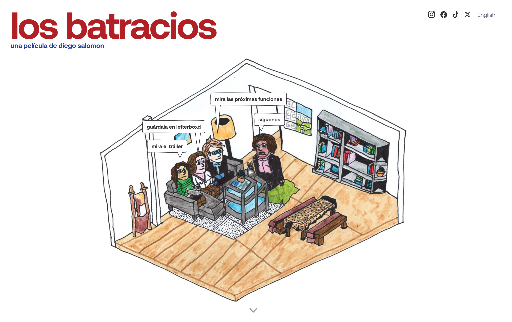
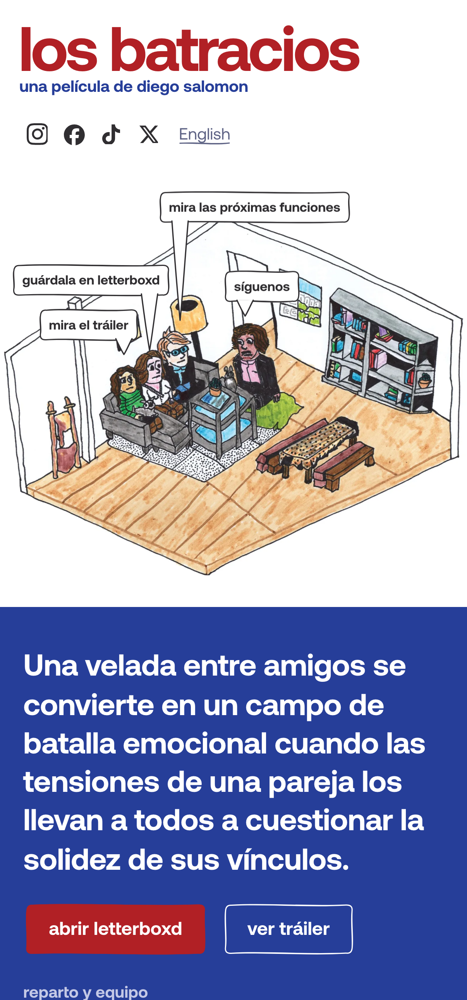

<div align="center">

# 🐸 losbatracios.com

### The bilingual site for my feature film *Los Batracios*: a fast, hand-built static site that turns a visitor into an audience I can write to again.

[](https://losbatracios.com)
[](https://pages.cloudflare.com)
[](#how-its-built)
[](#how-its-built)

### [Visit losbatracios.com](https://losbatracios.com) · [English](https://losbatracios.com/en/)

<br>



</div>

---

## About the film

*Los Batracios* is the feature I wrote, produced and directed on a €25k budget. It won the Audience Award and a Jury Honorable Mention at Mammoth Lakes, and played Nòt Film Fest, Molodist Kyiv, ELCO and VENEZCINE México.

I wanted a page that looks like the film, loads fast on a phone, and turns a visitor into someone I can reach again when the next screening comes up.

## How it's built

`build.py` builds the whole site from one place: the Spanish version at `/`, English at `/en/`, the privacy pages, the sitemap and robots, the share images, the redirects and the Cloudflare Worker. It's plain HTML with WebP images and no framework.

- **SEO on every page.** Its own title and description, Open Graph tags, a canonical URL, hreflang between the two languages, and `Movie` structured data with the cast and the awards.
- **A mailing list, without a backend.** A Cloudflare Worker checks each sign-up with Turnstile, adds the person to Buttondown tagged by language, and sends a welcome email.
- **Every channel gets its own short link** (`/ig`, `/tt`, `/qr`, `/prensa`, posters included), so Umami shows where the audience comes from without cookies or a cookie banner. `/resena` sends people leaving a screening straight to Letterboxd.
- **Secrets stay secret.** The API keys exist only as Cloudflare environment variables, and the code went through a security review before launch.

<div align="center">
<br>
<table>
<tr>
<td align="center" width="62%"><br><sub>Desktop</sub></td>
<td align="center" width="38%"><br><sub>On a phone</sub></td>
</tr>
</table>
</div>

## Run it

```bash
pip install pillow
python3 build.py              # writes the site to sitio/
npx wrangler pages deploy sitio --project-name <your-project>
```

`site/` holds a copy of what's live right now. Two things aren't in the repo: the Aeonik font, which is licensed, and the press kits. The build skips them with a warning and falls back to a system font. For the mailing list, set `BUTTONDOWN_API_KEY` and `TURNSTILE_SECRET_KEY` in Cloudflare and change `UMAMI_ID`, `TURNSTILE_SITEKEY` and the links at the top of `build.py` to your own.

The code comments are in Spanish.

---

<div align="center">
<sub>Built by <a href="https://github.com/diego-salomon">Diego Salomón</a>. · <a href="https://www.linkedin.com/in/diegosalomon">LinkedIn</a></sub>
</div>
